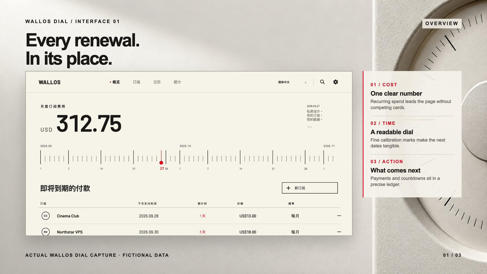
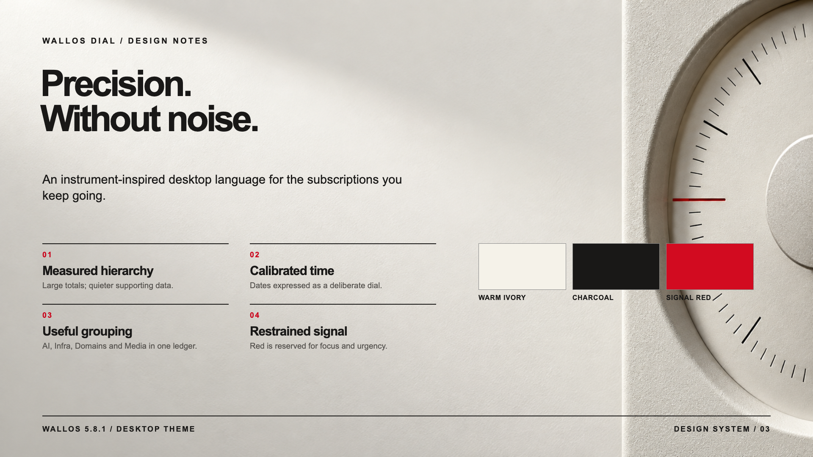
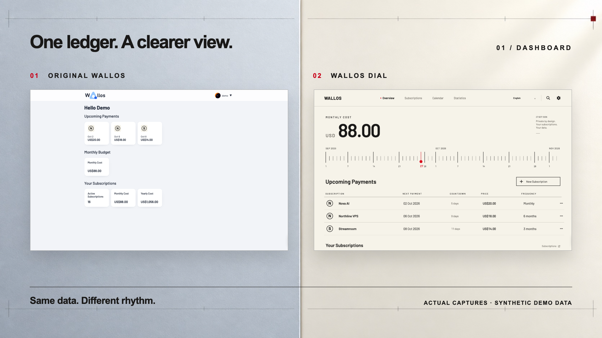

# Wallos Dial

[Product site](https://lukevoidx.github.io/wallos-dial-theme/) · [Try the interactive demo](https://wallos-demo.mostai.org/) · [English](README.md) · [简体中文](README.zh-CN.md) · [Manage categories](docs/CATEGORIES.md) · [Choose icons](docs/ICONS.md) · [Poster gallery](docs/CAMPAIGN.md) · [Before / after](docs/SHOWCASE.md) · [Install and upgrade](docs/UPGRADING.md)

A precise, warm, desktop-focused interface for [Wallos](https://github.com/ellite/Wallos). The theme adds an instrument-style dashboard timeline, a restrained type and color system, grouped subscription cards, clearer statistics, focused interaction states, a persistent language switch, and matching HTML email notifications. Wallos's subscription, calendar, settings, search, and notification features remain available.

**Dial 1.0.0:** tested with Wallos 5.8.3 only. Install the [versioned release](https://github.com/LukeVoidX/wallos-dial-theme/releases/tag/v1.0.0) through `ghcr.io/lukevoidx/wallos-dial:1.0.0`. The public Demo runs the same Dial and Wallos versions with fictional data. Dial is a source overlay built into a fixed Docker image, not an in-app Wallos theme option or an official Wallos project.

**Try it before installing:** [Open the live bilingual demo](https://wallos-demo.mostai.org/). It runs the actual 1.0 PHP application in an isolated container with 30 fictional subscriptions. Browse the overview, grouped subscriptions, view-only category manager, calendar, statistics, details, and language switch. The public environment is read-only; install your own instance to add or edit data and icons. [How the live demo works](docs/DEMO.md).



The UI inside this poster is a direct browser capture from an earlier isolated Dial demo account. Its subscription names, prices, and marks use fictional data. The [1.0 direct-capture gallery](docs/SHOWCASE.md) shows the current overview, grouped cards, category manager, icon chooser, and statistics using a separate 30-record fictional fixture. These screenshots document the installable 1.0 interface; they are not captures of a private account.

Compatibility is published per Wallos version. An upstream release does not automatically make an older Dial image compatible. The build checks the exact upstream files it replaces and stops on a mismatch; a newly tested Dial image is then published.

Dial is a source overlay built into a Docker image. It is not a native Wallos theme option, and it is not affiliated with the Wallos project. Upgrading Wallos requires rebuilding and reviewing the overlay against the new upstream version. See [Updating](docs/UPGRADING.md).

**Recommended for:** someone self-hosting Wallos 5.8.3 who wants a quieter, desktop-first view and is willing to keep a versioned image. If your priority is a phone-first UI or automatically taking every new Wallos release, wait for a compatible release before switching. Keep a database backup either way.

## Preview

The design uses warm off-white, dark numerals, fine lines, and a small red signal. It is tuned for desktop use. The original Wallos mobile layout remains available, but this release does not promise a separate mobile redesign.


[See all six product stories](docs/CAMPAIGN.md), including calendar, statistics, and the real demo. [简体中文图集](docs/CAMPAIGN.zh-CN.md).



| What you see | What it helps with |
|---|---|
| Monthly total and precise date dial | Read the recurring commitment and its timing at a glance. |
| Upcoming-payment countdown | See calendar days until the next three payments. |
| Grouped subscription ledger | Scan AI, infrastructure, domains, media, or your own categories. |
| Category manager | Add, rename, reorder, merge, and remove categories while keeping subscription records intact. [Read the guide](docs/CATEGORIES.md). |
| Icon chooser and My Icons | Keep each original Wallos Logo, select one of nine neutral catalog pictograms, or upload a private image to an account-scoped library. [Read the guide](docs/ICONS.md). |
| Unified calendar and statistics | Move between dates and costs without a change in visual language. |
| Quick language selector | Switch between English, Simplified Chinese, Traditional Chinese, and Wallos's other locales. |
| Matching account screens | Registration, login, TOTP, verification, and password reset use Dial's warm visual language while retaining Wallos's handlers. |
| Matching email templates | Renewal, cancellation, test, verification, and password-reset emails share Dial's typography and warm palette. |



[See the subscriptions comparison, other views, and full-resolution captures](docs/SHOWCASE.md).


The email comparison shows the original Wallos 5.8.1 plain-text renewal body and the HTML generated by Dial 0.1.1 for the same fictional subscriptions. It is a browser rendering of the templates, not a screenshot from an inbox. [See the source and rendering method](docs/SHOWCASE.md).

## Install a new instance

Requirements: Docker with Compose, an available local port `8282`, and a recent browser.

The pull-only `compose.yaml` pins the published `1.0.0` image. These commands create a new instance with its own local data volumes:

```bash
git clone https://github.com/LukeVoidX/wallos-dial-theme.git
cd wallos-dial-theme
docker compose up -d
```

Open `http://127.0.0.1:8282` from the same machine. The Compose file pulls a prebuilt versioned image and binds to loopback; use your own HTTPS reverse proxy and access controls if you need remote access. Set `TZ` in a local `.env` file if needed. Wallos stores its database in `./data/db` and uploaded subscription logos in `./data/logos`; both are excluded from Git.

For a server you access by SSH, keep the loopback binding and forward the port: `ssh -L 8282:127.0.0.1:8282 user@your-server`. Then open `http://127.0.0.1:8282` locally. Complete Wallos's normal first-run registration there.

Verify the container with `docker compose ps` and `curl -fsS http://127.0.0.1:8282/health.php`. On first start, the database and Dial migration finish and the PHP-FPM listener becomes available before Nginx accepts requests. `/health.php` returns `OK` only after the Dial migration is present; wait for it before registering the first account. If the service remains unready or assets fail, check [Troubleshooting](docs/TROUBLESHOOTING.md).

With Colima or a remote Docker daemon, confirm `./data/db/wallos.db` actually appears on the host before registering. If it does not, stop the container and correct directory sharing or the bind mount; a database visible only inside the VM is not a host backup.

Contributors can build the same source locally with `docker compose -f compose.build.yaml up -d --build`.

## Use an existing Wallos database

1. Back up the existing SQLite database and uploaded logos. Keep the previous image reference and Compose file for rollback.
2. Copy the repository locally and create a Git-ignored `.env` file with **absolute** paths to the existing mounted directories:

   ```dotenv
   WALLOS_DB_DIR=/absolute/path/to/current/db
   WALLOS_LOGOS_DIR=/absolute/path/to/current/logos
   TZ=Europe/Berlin
   ```

3. Run `docker compose config` and check the resolved mounts. Stop the old container before starting Dial on the same port; then run `docker compose up -d`.
4. Check login, subscription count, logos, dashboard, calendar, statistics, settings, and notifications. Do not re-enter subscriptions.

The theme does not seed or rewrite existing subscriptions. Wallos and Dial run database migrations on startup, so test the 1.0 image against a disposable copy of both volumes first. If your existing service uses other environment variables, proxy rules, or a different port, carry them into your deployment configuration deliberately. [Use the full backup and rollback procedure](docs/UPGRADING.md).

Do not mount a live database into a second running Wallos container. Stop the old container after backing up and validating your Dial Compose mounts.

## Manage categories and choose icons

Open **Subscriptions → Manage categories**, or **Settings → Categories → Manage categories**. Categories belong to the current account. Add, rename, reorder, merge or remove empty categories in one place. The optional AI / Infra / Domains / Media starter set is offered only to an account with no subscriptions; it does not replace an existing ledger. [Manage categories](docs/CATEGORIES.md).

The **Icon** control in Add/Edit and the card's **Change icon** action offer Original, Catalog and My Icons. The nine public catalog drawings are neutral, original pictograms associated with service names; they are not third-party brand logos. A selection and its plain/framed, color/monochrome and 80–120% presentation settings are stored per subscription. **Original** restores the existing Wallos Logo. My Icons stores normalized uploads in the current account's SQLite database, which makes the database backup important as well as the Logo volume. [Choose icons and review upload limits](docs/ICONS.md).

## Optional legacy vector mapping

Uploaded logos remain untouched and are fitted into a consistent tile by default. For a custom SVG, put it in `config/icons/` and uncomment the two read-only mounts in `compose.yaml`. Copy [`config/logo-map.example.php`](config/logo-map.example.php) to `config/logo-map.local.php`, then map the uploaded filename to your SVG filename. Unknown filenames keep their original uploaded logo.

The legacy map applies only where no explicit icon choice exists; selecting Original overrides it. [The catalog provenance and design rules](theme/images/dial-catalog/SOURCES.md) describe the nine first-party neutral pictograms. The repository contains no subscription data, uploaded logos, or private logo mappings. `config/icons/`, `config/logo-map.local.php`, `.env`, and `data/` are Git ignored; the private legacy Logo directory is excluded from Git and Docker builds.

## Language switch

Use the selector in the shared header to switch quickly between 简体中文, English, and 繁體中文. The menu also includes all other Wallos languages. Dial saves the choice to the existing Wallos account language field and language cookie; it persists across pages and sign-ins. User-entered subscription and category names remain as entered.

## Email notifications

Dial 1.0 retains the email design introduced in 0.1.1 for renewal, cancellation, SMTP test, email verification, and password-reset messages. Recipient selection, notification timing, and SMTP settings continue to use Wallos's existing rules. Every HTML message has a plain-text alternative; renewal, cancellation, and optional period-summary text now follow the recipient's account language in English, Simplified Chinese, or Traditional Chinese. Renewal, cancellation, verification, and password-reset subjects follow that language too. Other account languages fall back to English. User-entered names and amounts are never translated.

The optional button in renewal, cancellation, and test emails uses the **Server URL** configured in Wallos Admin (or `WALLOS_SERVER_URL` if your Wallos deployment manages that setting). If it is empty or invalid, those messages omit the button. Verification and password-reset links require a valid absolute HTTP(S) Server URL; the queued email is left unsent until it is corrected. No repository domain is inserted into user emails. Configure SMTP in Wallos as usual and send a test email before relying on notifications.

## Updates and compatibility

| Dial | Tested Wallos | Install image |
|---|---|---|
| 1.0.0 | 5.8.3 | `ghcr.io/lukevoidx/wallos-dial:1.0.0` |
| 0.1.1 | 5.8.1 | `ghcr.io/lukevoidx/wallos-dial:0.1.1` |
| 0.1.0 | 5.8.1 | `ghcr.io/lukevoidx/wallos-dial:0.1.0` |

Use a versioned Dial image; avoid `latest`. A weekly workflow detects new upstream Wallos releases. Maintainers inspect changed templates, run the compatibility gate and smoke checks, then publish a new Dial image. Until that verified image exists, keep the previous working version. [Upgrade and rollback details](docs/UPGRADING.md).

## What is included

- `theme/`: modified Wallos PHP, CSS, and JavaScript files at their in-container paths.
- `compose.yaml`: pull-only, loopback-bound deployment with persistent database and logo volumes.
- `Dockerfile` and `compose.build.yaml`: source build for contributors and pre-release checks.
- `compat/upstream-files.sha256`: hashes of every upstream file overwritten by the theme; a changed base fails the build pending review.
- `VERSION` and `WALLOS_VERSION`: theme release and tested upstream version.
- `docs/UPGRADING.md`: compatibility and rollback instructions.
- `docs/SHOWCASE.md`: direct, synthetic-data screenshots and before/after posters.
- `docs/index.html` and `docs/zh-CN/index.html`: bilingual GitHub Pages product pages linking to the isolated live demo.
- `docs/sitemap.xml` and `docs/SEARCH.md`: language URL discovery and search visibility boundaries.
- `demo/seed.py`: synthetic data and SVG logo generator for a fresh demo database.
- `docs/TROUBLESHOOTING.md`: startup, port, logo, cache, and compatibility checks.
- `README.zh-CN.md`: Simplified Chinese installation guide.
- `LICENSE.md`: GPLv3, matching the upstream project's license.

`./scripts/check-package.sh` validates the package. `docker build -t wallos-dial:local .` and `./scripts/smoke-image.sh wallos-dial:local` check a local image. The 1.0 release gate also exercises security, migration, rollback, startup readiness, account flows, browser layout, icons and categories. The release image is published for `linux/amd64` and `linux/arm64`; verify its tag and digest before an upgrade.

## Credits and license

Wallos Dial modifies [Wallos](https://github.com/ellite/Wallos), originally by ellite and contributors. Wallos and this derivative source are distributed under [GPLv3](LICENSE.md). Keep the upstream copyright and license notices when redistributing. No official Wallos endorsement is implied.

Suggestions and fixes are welcome. Read [Contributing](CONTRIBUTING.md) before proposing support for a new Wallos version. For bugs, include the Dial version, Wallos version, browser, and a redacted screenshot; never attach your database or credentials.
