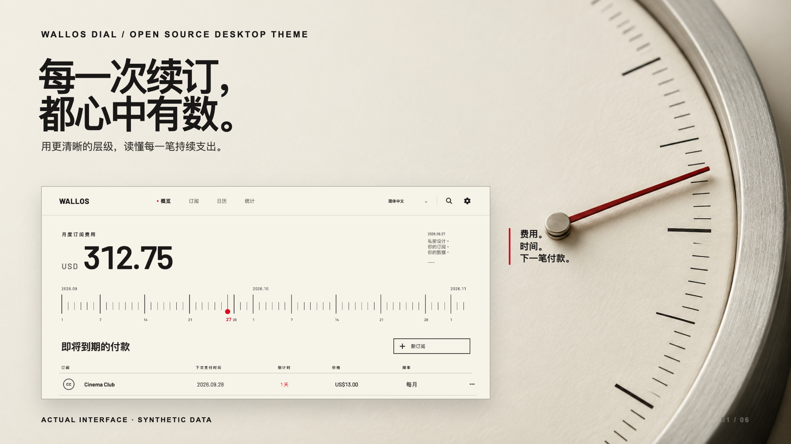
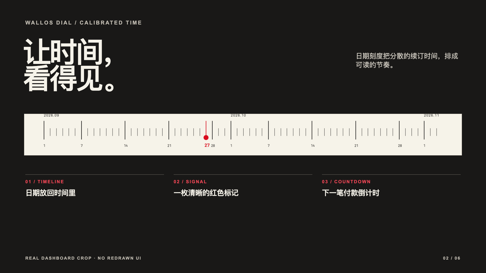
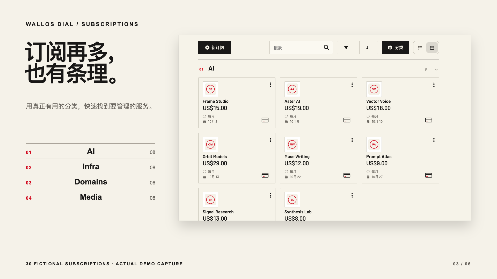
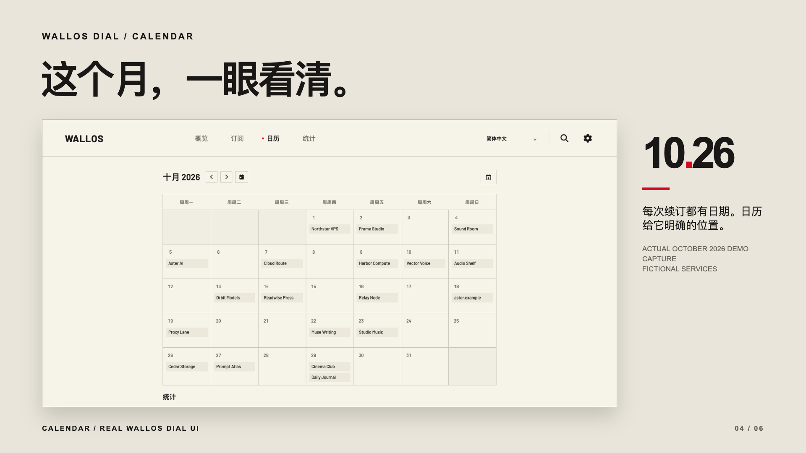
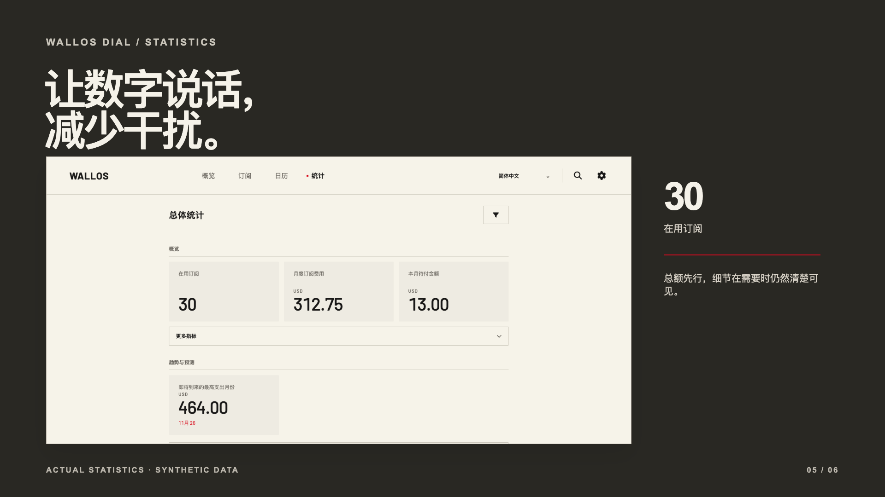
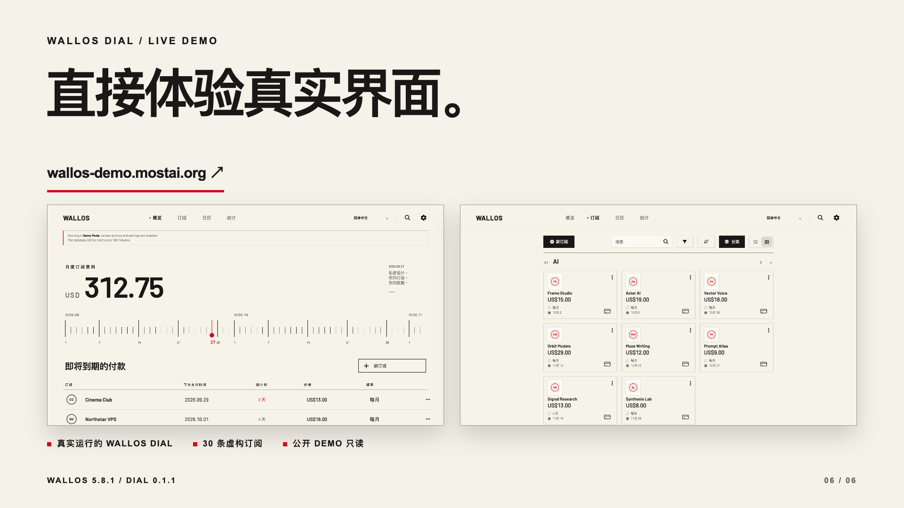

# Wallos Dial 主题海报

[English](CAMPAIGN.md) · **简体中文**

前六张海报分别介绍一个功能，使用运行在虚构订阅数据上的 Wallos Dial 截图。第七张展示邮件模板前后对比，由原版纯文本正文和 Dial 0.1.1 实际 HTML 模板渲染而成。ImageGen 只生成海报背景；标题、标注与版式由 HTML 排版。

## 01 · 总览

## 02 · 日期刻度与倒计时

## 03 · 分类订阅

## 04 · 日历

## 05 · 统计

## 06 · 在线体验

## 07 · 邮件通知

## 设计参考与使用边界

- [Actual Budget](https://actualbudget.org/) 用清楚的产品定位、真实界面和 Demo 入口引导读者。我们借鉴这种展示顺序，并保持 Wallos Dial 自己的视觉语言。
- [Paperless-ngx](https://docs.paperless-ngx.com/usage/) 用实际操作画面解释功能。这组海报同样保留真实浏览器截图。
- [Immich UI](https://ui.immich.app/introduction) 强调不同产品页面共享同一视觉系统。我们让颜色和字体层级保持一致，同时按功能调整每张海报的构图。
- [Penpot](https://penpot.app/) 将产品画面与具体能力对应。这里每张海报也只聚焦 Wallos Dial 的一个特点。

参考的是展示方法，没有复制这些项目的图片、界面或文案。中文主视觉与日期刻度使用 30 条虚构订阅的 Demo 截图；分类订阅、十月日历、统计和在线体验也使用该独立公开 Demo 的数据。服务名称、价格、标识与日期均为虚构。邮件图为模板渲染，不是邮箱收件箱截图。海报展示桌面布局；公开 Demo 只读。这些是 0.1.x 时期的历史画面；Dial 0.1.1 当时仅验证 Wallos 5.8.1。[1.0.0／Wallos 5.8.3 发布说明](RELEASE-NOTES-1.0.0.md)介绍当前正式版本，[1.0 直接截图](SHOWCASE.md#10-direct-browser-captures)展示更新后的实际界面。

[View the English posters and notes →](CAMPAIGN.md)
