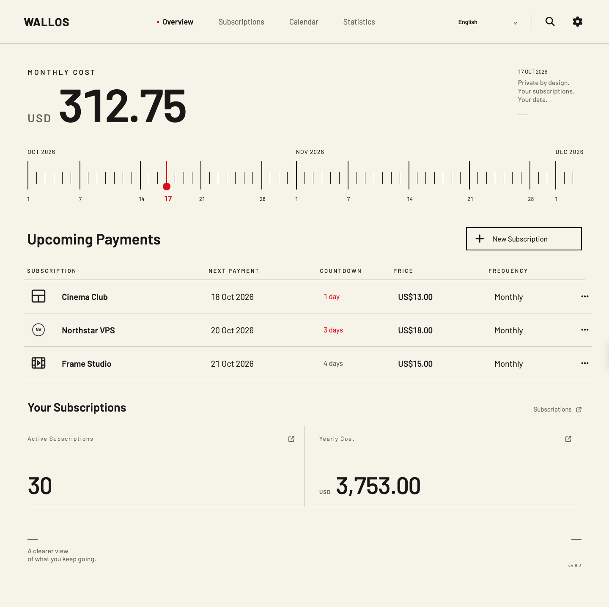

# Live Demo / 真实演示

[English product page](https://lukevoidx.github.io/wallos-dial-theme/) · [简体中文介绍](https://lukevoidx.github.io/wallos-dial-theme/zh-CN/) · [Open the live Demo](https://wallos-demo.mostai.org/)

**Current public Demo:** Wallos Dial 1.0.0 on Wallos 5.8.3. It is a separate, read-only installation with fictional records. The screenshot below is a direct 1.0 browser capture from an isolated fixture; [more 1.0 captures](SHOWCASE.md) show the same design. The older 0.1.x Demo captures remain available as [overview](assets/screenshots/real-demo-overview.png) and [subscriptions](assets/screenshots/real-demo-subscriptions.png) history.

These are direct browser captures from an isolated Wallos Dial container, not a recreated frontend or private account.

## English

GitHub Pages hosts static product information and cannot execute Wallos PHP/SQLite. The Demo URL points to a separate Wallos Dial container and SQLite/Logo volumes with one fictional account and **30 synthetic subscriptions** across AI, Infra, Domains and Media. The public 1.0 reset uses the [seed script](../demo/seed.py) in showcase mode, which rejects any data row outside reviewed fresh Wallos 5.8.3 defaults, including orphaned payment methods, tokens and private icons. No maintainer account, private subscription, uploaded Logo, API key or production database is mounted into this environment.

The public Demo is **read-only** at the Caddy edge and at the application's Demo Mode write guards. Visitors can browse overview, subscriptions, calendar, statistics, details, search, the date dial and a per-visitor language choice. The 1.0 proxy configuration also permits a GET of `/categories.php` as a view-only manager: it displays fictional categories and an installation prompt but cannot add, rename, merge, reorder or delete. Icon choices and My Icons uploads likewise require a personal installation. The 1.0 public edge denies both My Icons read endpoints, including images in the shared Demo account; the nine neutral catalog pictograms remain static public files.

The public reverse proxy blocks subscription/category/icon mutations and administrative routes. The only accepted POST is the language endpoint, which changes the visitor's Cookie without writing the shared database. The [1.0 reset job](../demo/README.md) restores the reviewed synthetic fixture; a health or public-route failure triggers its rollback procedure. The Demo is marked `noindex`; the bilingual GitHub Pages pages are the intended search entry points. Verify the route list, reset result and version through the public hostname after each update.

To try 1.0 edit flows, start your own **local, disposable** Wallos 5.8.3 installation with a synthetic database. Public Demo visitors cannot use account settings, add/edit forms, My Icons or category mutations. See [installation](../README.md#install-a-new-instance) and [Demo operations](../demo/README.md).

## 简体中文

GitHub Pages 只托管静态介绍页，无法执行 Wallos 的 PHP/SQLite。在线 Demo 使用独立容器、数据库及 Logo 数据卷，包含一个虚构账户与按 AI、Infra、Domains、Media 分类的 **30 条虚构订阅**。公开 1.0 重置流程以 showcase 模式调用[示例数据脚本](../demo/seed.py)，会拒绝任何超出 Wallos 5.8.3 全新预设值的数据，包括残留的私人付款方式、登录 token 和图标。这个环境不挂载维护者账户、私人订阅、上传 Logo、API 密钥或生产数据库。

公开 Demo 在 Caddy 代理和应用的 Demo Mode 两层保持**只读**。访客可以看总览、订阅、日历、统计、详情、搜索、日期刻度，并独立切换界面语言。1.0 的代理配置还允许以 GET 打开 `/categories.php`，但只显示虚构分类与安装提示，不能新增、改名、合并、排序或删除。图标选择与「我的图标」上传也需自行安装。1.0 公开代理会阻止「我的图标」两个读取接口，连共享 Demo 账户里的图片也不可直接取得；九枚中性图标仍可由静态目录读取。

代理阻止订阅、分类、图标修改和管理页面。唯一允许的 POST 是仅修改访客 Cookie 的语言接口，不写入共享数据库。[1.0 重置任务](../demo/README.md)会恢复经审核的虚构数据；健康检查或公开路由检查失败时会执行回退流程。Demo 页面标记为 `noindex`；中英文介绍页才是搜索入口。每次更新后，都应经公开网址核对版本、路由和重置结果。

公开 Demo 已运行基于 Wallos 5.8.3 的 Dial 1.0.0。需要体验新增、编辑、分类管理及「我的图标」时，请依[安装说明](../README.zh-CN.md#新安装)建立只用虚构数据的隔离实例；公开 Demo 不接受这些修改。
