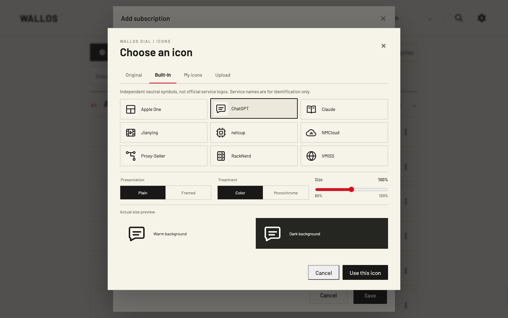

# 选择订阅图标

[简体中文](ICONS.md) · [English](../ICONS.md)

Wallos Dial 会保留每项订阅原有的 Wallos Logo。你可以选择**原图**、随主题提供的图标，或从**我的图标**中选择图片。选择和显示样式只属于当前账户，并统一用于首页、订阅卡片和详情。没有图片时会显示订阅名称的首字作为后备。

## 选择与调整

打开「**订阅 → 新增订阅**」或「**编辑**」，使用「**图标**」区域。卡片上的「**更换图标**」也会打开同一个选择器。选择「原图」「图标目录」或「我的图标」，在明暗背景上查看 60 px 实际尺寸预览，再调整无边框／边框、彩色／单色和 80%–120% 的大小。保存订阅后，选择才会写入。快捷更换只更新该订阅的图标偏好。

这是**尚未公开发布的 1.0 本地候选版**在虚构账号中的真实浏览器截图。九个服务名称只用于识别中性原创符号，图形并非第三方品牌 Logo。[完整本地截图](../SHOWCASE.md)还展示首页、分类卡片、分类管理和统计页面。[公开 Demo](https://wallos-demo.mostai.org/) 在 1.0 获批发布并完成部署前仍运行 0.1.1。

「**原图**」会明确恢复该订阅的 Wallos Logo；原有的明暗版本也会保留。移除目录图标或个人图标不会删除原图。若恢复备份后图标资源缺失，Dial 会改用原图或订阅名称首字。

新上传或通过网址获取的原始 Logo 在解码前限制为最多 4 MiB、任一边不超过 4096 px、总像素不超过 400 万。超限 Logo 会跳过并在表单中提示，订阅的其他字段仍可保存。

## 我的图标

支持 PNG、JPEG、WebP，以及只使用基本几何形状的 SVG。单个上传文件不得超过 **2 MiB**。系统按实际内容检查，缩放到不超过 **1024 × 1024 px**，去除原始元数据后重新编码；最终图像不超过 **512 KiB**。SVG 会先通过严格的元素和属性检查，在受限进程中转为位图，数据库只保存 PNG。脚本、内嵌内容、外部引用、字体、文字、动画和 CSS 都会被拒绝。复杂 SVG 可以先自行导出为 PNG 再上传。

每个账户最多保存 **100 张**图像、总计 **32 MiB** 的处理后数据。重复上传相同图像会复用已有记录。被订阅引用的图像须先更换选择，才能删除。个人图像只会通过已登录、禁止缓存的接口提供给所属账户。

选择器会显示当前图标数量和存储用量。达到任一上限时，点击「管理我的图标」即可打开图标库，删除未使用的图标后重试。如果图标正被某项订阅使用，请先更换该订阅的图标。

位图最长边不足 **128 px** 时仍可上传，但上传结果和「我的图标」列表会显示低分辨率提醒。放大显示尺寸不会补回缺失的细节。

「我的图标」保存在 Wallos 的 **SQLite 数据库**中。Wallos 原有 Logo，以及可选的私人旧版 SVG，仍在 **Logo 数据卷**里。升级前应同时备份数据库与 Logo 卷。回退到旧版 Dial 后，原有 Wallos Logo 仍可显示；回退数据库时应使用与 Logo 卷匹配的备份。详见[升级与回退](UPGRADING.md)。

## 原有的私人重绘图标

个人的 `WALLOS_DIAL_LOGO_MAP` 可以继续把原始 Logo 文件名映射到私人挂载的 `images/dial-logos/` SVG。只有订阅**没有明确选择图标**时，才会使用这个映射。明确选择「原图」会覆盖该订阅的旧映射。私人映射和 SVG 不包含在公开源码或镜像中；若希望图标随数据库备份保存，可以将图片导入「我的图标」。

[公开 Demo](https://wallos-demo.mostai.org/) 目前仍运行使用虚构订阅的 Dial 0.1.1。1.0 图标选择器现在只在本地候选版可用；正式发布后，Demo 也只供浏览，不能上传图像或保存选择。
